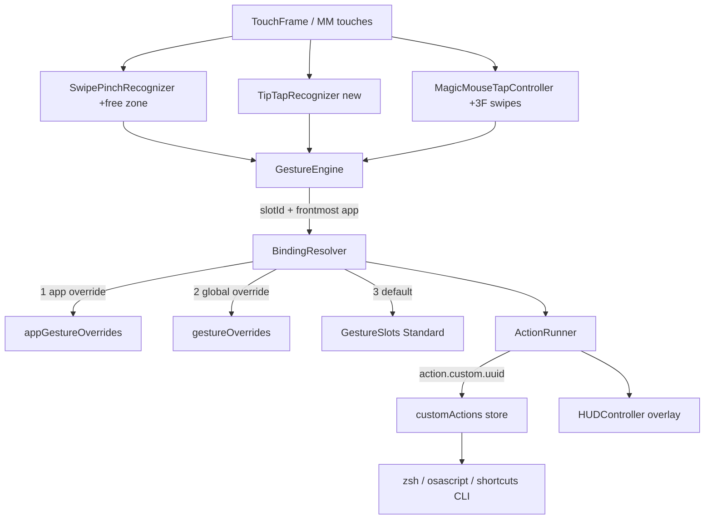

# Requirements

### Overview & Goals
Bring Sanne closer to BetterTouchTool / Multitouch feature parity by adding six features on top of the existing gesture engine:

1. **Free-space trackpad 3F/4F swipes** (+ 4F tap) — remappable to any catalog action
2. **Tip-tap gestures** — hold one finger, tap another to its left/right
3. **Magic Mouse 3-finger swipes** — L/R/U/D on the mouse surface
4. **Custom script actions** — run shell command, AppleScript, or macOS Shortcuts shortcut
5. **Per-app gesture bindings** — a gesture can trigger a different action per frontmost app
6. **HUD overlay feedback** — brief on-screen label showing the action that fired

### Scope
**In scope**
- New recognizers/slots wired end-to-end: recognizer → `GestureSlots` → `BindingResolver` → `ActionRunner` → Settings UI (Gestures editor, section toggles, cheat sheet/catalog)
- New `customActions` store + editor sheet in the remap editor
- Per-app override layer in `BindingResolver` + Apps tab UI
- HUD panel + global toggle
- Config import/export includes all new fields; old configs load unchanged (tolerant decoding pattern already in place)
- `PROGRESS.md` / `README.md` / `CHANGELOG.md` updates

**Out of scope**
- Drag-to-edge snap areas (not selected)
- Named presets/profiles, clipboard manager, key sequences, Touch Bar
- Condition engine beyond frontmost-app matching

### User Stories
- As a trackpad user, I want 3F/4F swipes in free space to trigger actions (e.g., 4F swipe left → previous tab) so I don't need BTT.
- As a power user, I want tip-taps for fast, low-travel triggers.
- As a Magic Mouse user, I want 3F swipes for app/tab switching like BTT's defaults.
- As a tinkerer, I want a gesture to run my shell script / AppleScript / Shortcut.
- As a multi-app user, I want the same gesture to do different things in Safari vs. Xcode.
- As any user, I want a HUD confirming which action fired so gestures feel predictable.

### Functional Requirements
- **FR1** Free-space slots: 3F swipe L/R/U/D, 4F swipe L/R/U/D, 4F tap — all remappable; **disabled by default** (macOS consumes system 3F/4F swipes; Settings shows a hint to disable the System Settings equivalents when enabling).
- **FR2** Tip-tap slots: 1F-hold + tap-left, 1F-hold + tap-right; disabled by default; sensitivity follows `trackpad.sensitivity`.
- **FR3** Magic Mouse 3F swipe slots L/R/U/D; defaults: L/R → prev/next tab (BTT-like), U/D → Mission Control / App Exposé; enabled off by default to avoid surprises.
- **FR4** Remap editor "Action" picker gains: *Run Shell Command…*, *Run AppleScript…*, *Run Shortcut…* — each creates/edits an entry in the custom-action store; entries are named, reusable across gestures, and survive import/export.
- **FR5** Apps tab: besides pause scopes, an app row can define per-gesture overrides; effective binding = app override → global override → Sanne Standard default; "modified" badges reflect app-level state when that app is frontmost.
- **FR6** HUD: ~0.8 s fade overlay near screen-bottom-center with action title; global toggle in Settings → General; never shown for continuous actions (drag, window move) or plain clicks.

### Non-Functional Requirements
- No regression to existing recognizers (tap-to-click latency, 3F drag arbitration).
- Shell/AppleScript run async off the main thread; failures logged to the Debug Log, never crash.
- Config decode stays tolerant: unknown/missing keys keep defaults (existing `decodeIfPresent` pattern).

# Technical Design

### Current Implementation
- `Gestures/GestureEngine.swift` routes `TouchFrame`s by `CursorZone`; free space only runs `ThreeFingerDragRecognizer` + 3F-tap.
- `Gestures/GestureSlots.swift` defines fixed slots + `BindingResolver.resolve(slotId:config:)` (global `gestureOverrides` only).
- `Actions/ActionCatalog.swift` uses encoded dynamic ids (`keystroke.custom.*`, `app.launch.*`); `Actions/ActionRunner.swift` executes ids.
- `TouchInput/MagicMouseTapController.swift` emits `.recognized(slotId, clickCount)`; already tracks per-finger paths for 2F swipes.
- `Config/ConfigModels.swift` + `Config/GestureBinding.swift` hold config; `UI/Preferences/GestureEditorView.swift` is the remap editor.
- `Windowing/SnapPreviewWindow.swift` is the reference for a borderless overlay panel.

### Key Decisions (confirmed)
- **Custom actions**: UUID-referenced store — `customActions: [CustomActionDef]` in `SanneConfig`, referenced as `action.custom.<uuid>`. Rationale: scripts are multi-line, editable, reusable (vs. base64-in-id).
- **Per-app bindings**: app layer above global — `appGestureOverrides: [String: [String: GestureOverrideEntry]]`; `BindingResolver` gains an optional `frontmostBundleId` and checks app → global → default. Rationale: minimal, predictable; avoids condition-engine redesign.
- **Free-space recognition**: extend `SwipePinchRecognizer` to emit finger-count-aware outcomes for the `.free` zone; add one focused `TipTapRecognizer`. Rationale: reuse proven thresholds; only tip-tap needs new state.

### Proposed Changes
**1. Free-space swipes** — `SwipePinchRecognizer.process` records finger count at gesture start and emits swipe outcomes for `.free` when count ≥ 3; `GestureEngine.handleOnMain` maps them to new slots (arbitration: 3F swipe suppressed while `threeFingerDrag.isDragging`; 3F swipe only fires if drag is disabled or movement is fast/short per existing thresholds). New `TrackpadConfig` fields + Settings → Trackpad toggles.

**2. Tip-tap** — new `Gestures/Recognizers/TipTapRecognizer.swift`: anchor = finger down > 150 ms with low movement; tap = second finger down+up < 250 ms; side from x-offset vs. anchor. Runs only in `.free` zone, mutually exclusive with 3F drag.

**3. Magic Mouse 3F swipes** — in `MagicMouseTapController`, extend the existing 2F-swipe path to 3 fingers (same displacement thresholds); emits `.recognized(GestureSlots.ID.mm3fSwipe*)`. Must not break the 3F→middle-click touch slot: middle-click only commits if total movement stays under the swipe threshold.

**4. Custom actions** — new `Config` model + runner extension:
- `ActionRunner`: on `action.custom.<uuid>` prefix, look up the def and dispatch on a background queue: shell via `Process("/bin/zsh", "-lc", script)`, AppleScript via `NSAppleScript`/`osascript`, Shortcuts via `Process("/usr/bin/shortcuts", "run", name)`.
- `ActionCatalog.title(for:)` resolves the custom action's display name; deleting a def falls back bindings to `none` gracefully.
- `GestureEditorView` `ActionPickerSheet` gains three rows opening a `CustomActionSheet` (name + type + text editor / shortcut name picker via `shortcuts list`).

**5. Per-app bindings** — `BindingResolver.resolve(slotId:config:frontmostBundleId:)` (nil keeps current behavior; existing call sites pass `NSWorkspace.shared.frontmostApplication?.bundleIdentifier` from the engine's cached value). `PreferencesView` Apps tab: per-app row → "Customize gestures…" reusing `GestureEditorView` in app-scoped mode (writes to `appGestureOverrides[bundleId]`).

**6. HUD** — new `UI/HUDController.swift`: singleton with a floating, non-activating `NSPanel` (pattern from `SnapPreviewWindow`), `show(title:)` with fade-out. Called from `GestureEngine.runSlot` / `handleMagicMouse` after successful `ActionRunner.run`, gated by `config.hud.enabled` and an action allow-list (skip clicks/drag/moveWindow).

### Data Models / Contracts
```swift
// Config/CustomAction.swift (new)
struct CustomActionDef: Codable, Equatable, Identifiable {
    enum Kind: String, Codable { case shell, appleScript, shortcut }
    var id: UUID
    var name: String
    var kind: Kind
    var payload: String        // script text or shortcut name
}
// SanneConfig additions (tolerant decode like existing keys)
var customActions: [CustomActionDef] = []
var appGestureOverrides: [String: [String: GestureOverrideEntry]] = [:]
var hud: HUDConfig = .init()   // { enabled: Bool = true }

// New GestureSlots.ID entries
free3SwipeLeft/Right/Up/Down, free4SwipeLeft/Right/Up/Down, free4Tap,
tipTapLeft, tipTapRight, mm3fSwipeLeft/Right/Up/Down

// BindingResolver
static func resolve(slotId: String, config: SanneConfig,
                    frontmostBundleId: String? = nil) -> ResolvedGesture?
```

### File Structure
- **New**: `Gestures/Recognizers/TipTapRecognizer.swift`, `Config/CustomAction.swift`, `UI/HUDController.swift`, `UI/Preferences/CustomActionSheet.swift`
- **Modified**: `SwipePinchRecognizer.swift`, `GestureEngine.swift`, `GestureSlots.swift`, `MagicMouseTapController.swift`, `ActionCatalog.swift`, `ActionRunner.swift`, `ConfigModels.swift`, `GestureBinding.swift`, `GestureEditorView.swift`, `PreferencesView.swift`, `UI/Help/GestureCatalog.swift`, `PROGRESS.md`, `README.md`, `CHANGELOG.md`

### Architecture Diagram


### Risks
- **macOS system gesture conflicts**: private MT registration does not suppress system 3F/4F swipes → ship disabled by default + Settings hint; document in cheat sheet.
- **3F arbitration**: free-space now has 3F tap, 3F drag, 3F swipe, tip-tap — order: drag (if enabled) > swipe > tap; tip-tap requires a stationary anchor so it can't collide with swipes.
- **Script safety**: run async, 10 s timeout, capture stderr to `Log`; never block the gesture thread.
- **Config growth**: all new keys use `decodeIfPresent` with defaults; export/import round-trips them.

# Testing

### Validation Approach
No test target exists (`Package.swift` has only the executable), and gestures need physical hardware. Validation = `swift build` cleanliness, targeted debug-log verification via the existing `Log`/Debug Log tab, config round-trip checks, plus a hardware QA checklist appended to `PROGRESS.md` for the user.

### Key Scenarios
- `swift build` succeeds with zero warnings introduced.
- Config round-trip: encode a config containing `customActions`, `appGestureOverrides`, `hud`, and new slot overrides → decode → equal; decode a pre-change `config.json` → all new fields at defaults.
- `BindingResolver`: app override beats global beats default; nil bundle id preserves today's behavior; disabled master group still wins.
- `ActionRunner` custom actions: shell `echo` runs and logs; unknown UUID logs a warning and returns `false`; Shortcuts path handles missing `shortcuts` binary gracefully.
- HUD: fires once per committed action, skips clicks/drag, respects the toggle.

### Edge Cases
- 3F drag enabled + 3F swipe enabled: drag wins once dragging starts; no synthetic mouse-up leaks.
- 4F touch that loses a finger mid-gesture (count 4→3) must not double-fire both slots (finger count locked at gesture start).
- Tip-tap anchor drift > threshold cancels the gesture (no phantom triggers while scrolling).
- Magic Mouse 3F: middle-click still works when fingers don't move; swipe suppresses the middle-click.
- Deleting a custom action that a binding references → binding resolves to `none`, editor shows "Missing action".
- Per-app override for an app that is uninstalled → row still listed, no crash.

### Test Changes
- Add a `SanneTests` target (swift-testing or XCTest) with pure-logic tests only: `BindingResolver` precedence, config decode tolerance/round-trip, `TipTapRecognizer` state machine fed synthetic `TouchFrame`s, `SwipePinchRecognizer` free-zone finger-count outcomes.
- Hardware-dependent flows stay manual: extend the "Suggested next steps" QA list in `PROGRESS.md`.

# Delivery Steps

### ✅ Step 1: Add free-space 3F/4F swipe and 4F tap gesture slots
Trackpad free-space 3F/4F swipes and 4F tap are recognized and remappable in Settings → Gestures.

- Extend `SwipePinchRecognizer` to lock finger count at gesture start and emit swipe outcomes for the `.free` zone (3+ fingers).
- Route free-zone outcomes in `GestureEngine.handleOnMain` to new slots: `free3Swipe*`, `free4Swipe*`, `free4Tap` — arbitrated against `ThreeFingerDragRecognizer` (drag wins while dragging) and the existing 3F tap.
- Add slot definitions (disabled by default) to `GestureSlots` with sensible default actions (e.g., 4F left/right → prev/next tab).
- Add `TrackpadConfig` fields + Settings → Trackpad toggles with a hint about disabling the matching macOS system gestures.
- Create the `SanneTests` target with initial tests for the recognizer's free-zone finger-count outcomes and config decode tolerance.

### ✅ Step 2: Implement TipTapRecognizer and tip-tap slots
Tip-tap left/right gestures fire remappable actions in free space.

- New `Gestures/Recognizers/TipTapRecognizer.swift`: stationary anchor finger (>150 ms, low movement) + quick second-finger tap; side determined by x-offset; scaled by `trackpad.sensitivity`.
- Wire into `GestureEngine` free-space path, mutually exclusive with 3F drag and free-space swipes.
- Add `tipTapLeft` / `tipTapRight` slots (disabled by default) + Settings toggle.
- Unit-test the recognizer state machine with synthetic `TouchFrame` sequences (anchor drift cancel, tap timeout, side detection).

### ✅ Step 3: Add Magic Mouse 3-finger swipe slots
3-finger swipes on the Magic Mouse surface trigger remappable actions without breaking the 3F middle-click.

- Extend the 2F swipe tracking in `MagicMouseTapController` to 3 fingers, emitting `.recognized(mm3fSwipe*)` events.
- Guard the existing 3F → middle-click slot: it only commits when total movement stays below the swipe threshold.
- Add `mm3fSwipeLeft/Right/Up/Down` slots (off by default; L/R default to prev/next tab, U/D to Mission Control / App Exposé) + Settings → Magic Mouse toggles.
- Update `UI/Help/GestureCatalog.swift` cheat-sheet entries for all new gestures from stages 1–3.

### ✅ Step 4: Add shell / AppleScript / Shortcuts custom actions
Gestures can run a named shell command, AppleScript, or macOS Shortcuts shortcut via the remap editor.

- New `Config/CustomAction.swift`: `CustomActionDef { id, name, kind, payload }`; add `customActions: [CustomActionDef]` to `SanneConfig` (tolerant decode; included in import/export).
- `ActionRunner`: handle `action.custom.<uuid>` prefix — dispatch async off-main via `/bin/zsh -lc`, `NSAppleScript`, or `shortcuts run`, with 10 s timeout and stderr logged to `Log`.
- `ActionCatalog.title(for:)` resolves custom action names; missing UUID falls back to `none` with a "Missing action" label.
- New `UI/Preferences/CustomActionSheet.swift` (name + kind + script editor / shortcut picker) reachable from `ActionPickerSheet` in `GestureEditorView`.
- Tests: config round-trip with custom actions; runner handles unknown UUID and missing `shortcuts` binary gracefully.

### ✅ Step 5: Implement per-app gesture bindings
The same gesture can trigger different actions depending on the frontmost app.

- Add `appGestureOverrides: [String: [String: GestureOverrideEntry]]` to `SanneConfig` + mutation helpers in `GestureBinding.swift`.
- Change `BindingResolver.resolve` to accept optional `frontmostBundleId` with precedence app override → global override → Standard default; pass the engine's cached frontmost bundle id from `GestureEngine` and `MagicMouseTapController` call sites.
- Extend Settings → Apps: per-app row gains "Customize gestures…" opening `GestureEditorView` in app-scoped mode writing to that app's override map.
- Include app overrides in import/export and the "modified" badge counts.
- Tests: resolver precedence matrix (app/global/default × enabled/disabled), nil-bundle-id backward compatibility.

### ✅ Step 6: Add HUD overlay feedback and finalize docs
A brief HUD shows the fired action's name, and project docs reflect all six new features.

- New `UI/HUDController.swift`: floating non-activating `NSPanel` (borrowing the `SnapPreviewWindow` pattern) with `show(title:)` and ~0.8 s fade-out.
- Invoke from `GestureEngine.runSlot` / `handleMagicMouse` after successful `ActionRunner.run`, gated by new `hud.enabled` config and an allow-list (skip clicks, drag, continuous window move).
- Add the HUD toggle to Settings → General.
- Update `PROGRESS.md` (new feature rows + extended hardware QA checklist), `README.md` features list, and `CHANGELOG.md`.
- Final validation: clean `swift build`, full test suite pass, import/export round-trip of a config exercising every new field.